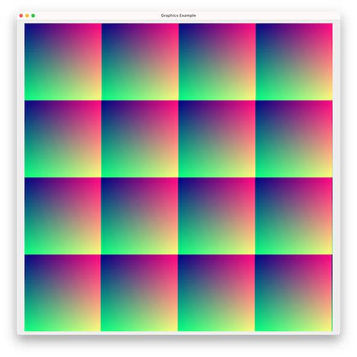
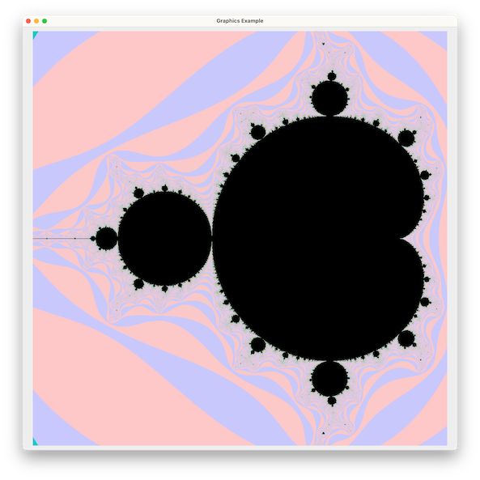

# 導入：オブジェクトとクラス

1. 導入 - [`ex01_phones.scala`](src/ex01_phones.scala)

1. クラス定義 - [`ex02_complex1.scala`](src/ex02_complex1.scala)

1. クラス定義（`val` と `def`） - [`ex03_complex2.scala`](src/ex03_complex2.scala)

1. クラス定義（コンストラクタの `val` 引数） - [`ex04_complex3.scala`](src/ex04_complex3.scala)

1. オブジェクト表現が与えるメモリシステムへの影響 - [`ex05_memory.scala`](src/ex05_memory.scala)

1. `class Complex` の応用例：グラフィックス - [`ex06_graphics.scala`](src/ex06_graphics.scala)

     

# 文字化けについての注意事項

Windows でこの sbt プロジェクトを使う場合は、日本語出力が文字化けすることがあります。その場合は、`project/programming1.scala` の以下の行を削除してから、sbt を再起動してみて下さい。

~~~
      run / fork          := true,
      run / connectInput  := true,
~~~
